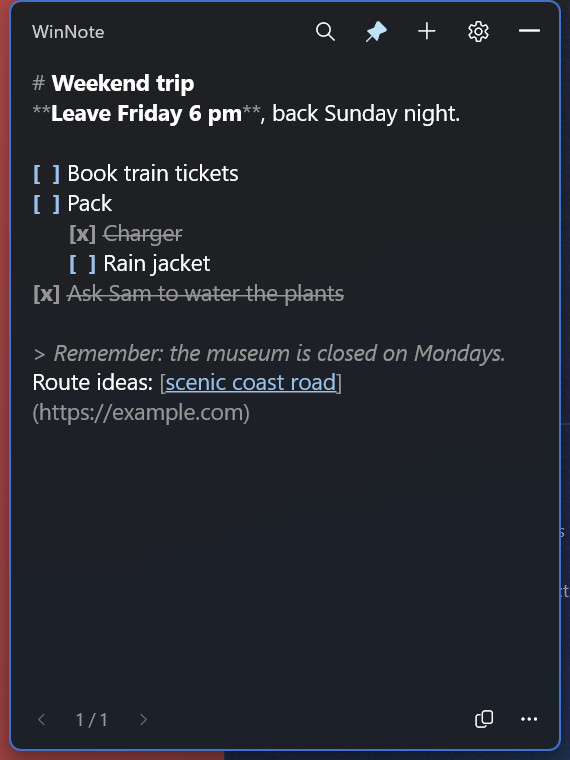

# WinNote: an Antinote alternative for Windows

**WinNote** is a free, lightweight scratchpad for Windows 11, inspired by the Mac app
Antinote. It lives in the system tray, opens instantly with a hotkey,
and is made for quick notes, todo lists and things you only need for a moment.

If you used Antinote on a Mac and want something similar on Windows, this is for you.



## Features

- **Instant**: press **Ctrl+Alt+N** anywhere to show or hide it. It hides again when you click away.
- **Todo lists in plain text**: type `[ ]` to make a checkbox, click it (or press Ctrl+Enter) to tick it off.
  Tab makes sub-todos.
- **Markdown as you type**: headings, **bold**, *italic*, ~~strike~~, `code`, quotes, lists and links.
- **Several notes**: Ctrl+N for a new note, Ctrl+←/→ to flip between them, Ctrl+F to search all of them.
- **Pin on top** to keep a note visible while you work.
- **Native Windows 11 look**: Mica, light/dark mode, your accent colour.
- **Private**: no account, no cloud, no telemetry, no network access. Notes stay on your PC.
- **Tiny and fast**: opens in about 5 ms and uses a few MB of memory while hidden.

## Download

Get the latest **WinNote-x.y.z-x64.msi** from the [Releases page](../../releases/latest) and
double-click it.

- Installs for your user only, with no admin prompt. It upgrades older versions and keeps your notes.
- The installer isn't code-signed yet, so Windows SmartScreen may warn: choose
  **More info → Run anyway**.
- Requires Windows 11 (x64).

## Keyboard shortcuts

| Action | Shortcut |
|---|---|
| Show / hide WinNote | **Ctrl+Alt+N** (change it in Settings) |
| Hide | Esc |
| New note | Ctrl+N |
| Previous / next note | Ctrl+← / Ctrl+→ |
| Delete note (undo for 5 s) | Ctrl+W |
| Search all notes | Ctrl+F |
| Toggle a todo, or turn a line into one | Ctrl+Enter |
| Indent / outdent (sub-todo) | Tab / Shift+Tab |
| Open a link | Ctrl+Click |
| Undo / redo | Ctrl+Z / Ctrl+Y |

The ⋯ menu has **Clear completed**, **Export as .txt** and **Export as Markdown**.
Right-click the tray icon for Settings, Start with Windows and Exit.

## Your data

Notes are saved automatically to `%LOCALAPPDATA%\WinNote\notes.json`, as plain text. Each
save keeps the previous version as a `.bak` file. Uninstalling WinNote leaves your notes in
place.

## Build from source

You need the [.NET 10 SDK](https://dotnet.microsoft.com/download). Release builds also need
Visual Studio Build Tools with the "Desktop development with C++" workload (for Native AOT).

```powershell
# Run a debug build (uses its own data folder, WinNote.Dev, so it never touches your notes)
dotnet build src\WinNote\WinNote.csproj -c Debug -p:Platform=x64
.\src\WinNote\bin\x64\Debug\net10.0-windows10.0.22621.0\win-x64\WinNote.exe

# Run the tests
dotnet test tests\WinNote.Tests\WinNote.Tests.csproj

# Build the installer (artifacts\WinNote-<version>-x64.msi)
powershell -ExecutionPolicy Bypass -File build-installer.ps1
```

Built with WinUI 3 (Windows App SDK), .NET 10 and Native AOT. The installer uses WiX Toolset 5.

## About the name

WinNote is an independent project. It is not affiliated with or endorsed by Antinote or its
developer; the name is only used to describe what WinNote is similar to.
